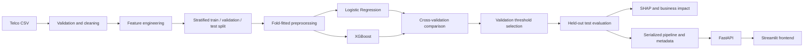

# Telco Customer Churn Prediction

Production-oriented machine-learning project for identifying customers who are most likely to churn and prioritizing retention outreach.

The project compares Logistic Regression and XGBoost with the same leakage-safe train/validation/test design, explains predictions with SHAP, estimates retention economics, and serves the saved pipeline through FastAPI. A Streamlit frontend provides a simple business-facing scoring workflow.

## What this project demonstrates

- Reproducible customer churn modeling on the IBM Telco Customer Churn dataset.
- Feature engineering for service adoption and average monthly spend.
- Preprocessing inside a scikit-learn pipeline to avoid leakage.
- Cross-validated comparison of Logistic Regression and XGBoost.
- Threshold selection on validation data only.
- Final evaluation on an untouched held-out test set.
- SHAP feature importance with business-level driver aggregation.
- FastAPI inference endpoint with schema validation and health checks.
- Streamlit frontend connected to the FastAPI backend.
- Docker packaging for the backend service.

## Architecture



## Results

The current saved artifacts were produced by [main.ipynb](./main.ipynb) in the `ai` Conda environment.

### Same held-out test set, default probability threshold 0.50

| Model | Accuracy | Precision | Recall | F1 | ROC-AUC | PR-AUC | Brier |
|---|---:|---:|---:|---:|---:|---:|---:|
| Logistic Regression | 0.7474 | 0.5165 | 0.7794 | 0.6213 | 0.8447 | 0.6577 | 0.1629 |
| XGBoost | 0.7512 | 0.5227 | 0.7367 | 0.6115 | 0.8310 | 0.6497 | 0.1603 |

Logistic Regression is the selected model because it achieved the strongest cross-validation ROC-AUC in the notebook and provides a strong, interpretable baseline. The validation-tuned operating threshold is **0.541**.

At that threshold, the selected model achieved **0.8447 ROC-AUC**, **0.6577 PR-AUC**, **0.7438 recall**, and **0.6248 F1** on the untouched test set.

### Retention scenario

The notebook includes an explicit scenario rather than presenting a causal claim:

- 80% campaign reach
- 20% assumed save rate
- $100 retention cost per contacted customer
- 70% contribution-margin rate

Under those assumptions, the current test-set targeting strategy scales to approximately **2,585 targeted customers**, **414 retained customers**, and **$56,817 estimated net annual savings** across the full dataset. These values must be validated with a randomized retention experiment before operational budgeting.

## Explainability

The notebook calculates SHAP values on held-out test records and aggregates one-hot encoded columns into business-level drivers. The strongest current drivers include:

- Tenure
- Contract type
- Internet service
- Total charges
- Monthly charges
- Online security
- Payment method
- Technical support

Recommended actions include early-life onboarding for new customers, contract-renewal offers, service-quality reviews, payment-friction reduction, and proactive technical support. These are prioritization recommendations, not guaranteed interventions.

## Repository layout

```text
.
├── main.ipynb
├── app.py
├── frontend/
│   ├── streamlit_app.py
│   └── requirements-frontend.txt
├── artifacts/
│   ├── telco_churn_pipeline.joblib
│   └── telco_churn_metadata.json
├── requirements.txt
├── Dockerfile
└── WA_Fn-UseC_-Telco-Customer-Churn.csv
```

## Run in the requested Conda environment

```powershell
conda activate ai
cd C:\Amulya\Projects\Telco-Customer-Churn
```

### Re-run the complete notebook

```powershell
python -m nbconvert --to notebook --execute --inplace main.ipynb --ExecutePreprocessor.timeout=600
```

The notebook recreates the model artifacts in `artifacts/`.

### Start the FastAPI backend

```powershell
python -m pip install -r requirements.txt
uvicorn app:app --host 0.0.0.0 --port 8000
```

Open `http://127.0.0.1:8000/docs`.

Endpoints:

- `GET /` - service links
- `GET /health` - model readiness, threshold, metrics, and versions
- `POST /predict` - validated raw customer record to churn prediction

### Start the Streamlit frontend

In a second terminal:

```powershell
conda activate ai
cd C:\Amulya\Projects\Telco-Customer-Churn
python -m pip install -r frontend\requirements-frontend.txt
streamlit run frontend\streamlit_app.py
```

For a separate hosted backend:

```powershell
$env:CHURN_API_URL = "https://your-api.example.com"
streamlit run frontend\streamlit_app.py
```

### Run with Docker

```powershell
docker build -t telco-churn-api .
docker run --rm -p 8000:8000 telco-churn-api
```

The image serves only the FastAPI backend. Run Streamlit as a separate frontend service and set `CHURN_API_URL` to the backend URL.

## Leakage and reliability controls

- Customer identifiers and target labels are excluded from model features.
- Feature engineering is deterministic and performed before inference in the same way as training.
- Imputation, scaling, and one-hot encoding are fit through the pipeline.
- Cross-validation is performed on training data only.
- Threshold selection uses validation labels only.
- Test labels are used only for final reporting.
- Notebook assertions verify disjoint splits and finite predictions.
- The API rejects missing or invalid required numeric fields.

## Limitations

This is a public, static dataset and is not evidence of live telecom performance. Production use should add time-based validation, drift monitoring, model and data versioning, access control, request logging with privacy controls, and an experimentally measured retention uplift.
